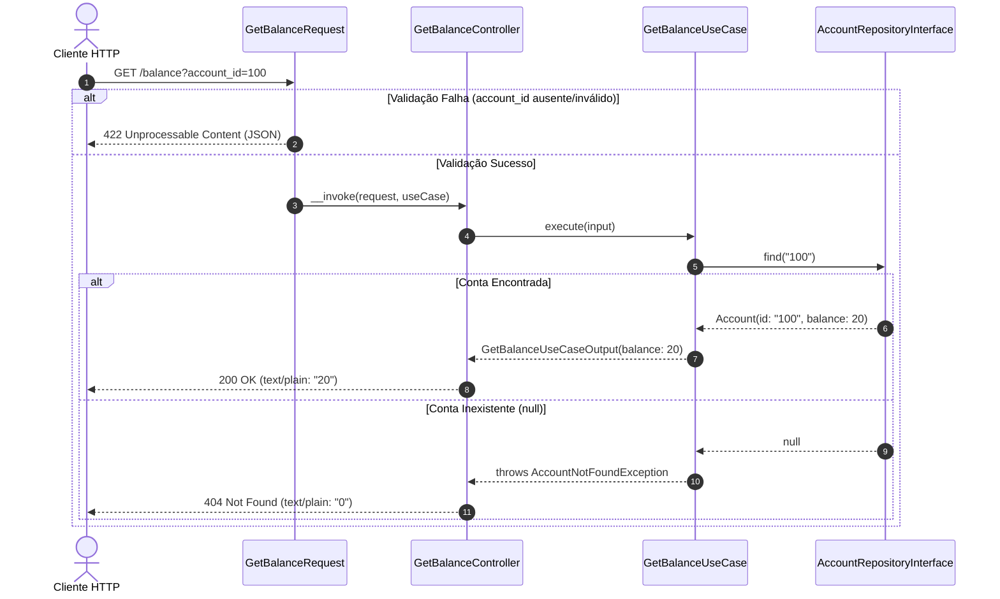

# Data Model: SPEC-04 — Consulta de Saldo, Tríade do UseCase e Endpoint GET /balance

Este documento define os modelos de transferência de dados (DTOs) da tríade do caso de uso, as entidades de domínio e as exceções envolvidas na operação de consulta de saldo.

---

## 1. DTO de Entrada: `GetBalanceUseCaseInput`

- **Localização:** `app/UseCases/Account/GetBalance/GetBalanceUseCaseInput.php`
- **Mutabilidade:** Imutável (`readonly class`).
- **Finalidade:** Encapsula o identificador validado da conta a ser consultada, isolando a camada de aplicação de instâncias da requisição HTTP.

### Atributos e Métodos
```php
namespace App\UseCases\Account\GetBalance;

use App\Http\Requests\Account\GetBalanceRequest;

final readonly class GetBalanceUseCaseInput
{
    public function __construct(
        public string $accountId
    ) {}

    public static function fromRequest(GetBalanceRequest $request): self
    {
        /** @var string $accountId */
        $accountId = $request->validated('account_id');

        return new self($accountId);
    }

    /**
     * @param array<string, mixed> $data
     */
    public static function fromArray(array $data): self
    {
        return new self((string) ($data['account_id'] ?? ''));
    }
}
```

---

## 2. DTO de Saída: `GetBalanceUseCaseOutput`

- **Localização:** `app/UseCases/Account/GetBalance/GetBalanceUseCaseOutput.php`
- **Mutabilidade:** Imutável (`readonly class`).
- **Finalidade:** Transporta o valor numérico do saldo obtido para o Controller de forma fortemente tipada.

### Atributos e Métodos
```php
namespace App\UseCases\Account\GetBalance;

final readonly class GetBalanceUseCaseOutput
{
    public function __construct(
        public int|float $balance
    ) {}

    public function toValue(): string
    {
        return (string) $this->balance;
    }
}
```

---

## 3. Exceção de Domínio: `AccountNotFoundException`

- **Localização:** `app/Exceptions/AccountNotFoundException.php`
- **Herança:** `\Exception` (agnóstica de HTTP).
- **Finalidade:** Sinalizar para as camadas superiores que a conta solicitada não foi localizada no repositório.

### Estrutura
```php
namespace App\Exceptions;

use Exception;

class AccountNotFoundException extends Exception
{
    public function __construct(string $accountId)
    {
        parent::__construct(sprintf('Account with ID "%s" not found.', $accountId));
    }
}
```

---

## 4. Entidade de Domínio: `Account` (Model Eloquent)

- **Localização:** `app/Models/Account.php`
- **Tabela:** `accounts`
- **Campos Utilizados:**
  - `id`: string (chave primária não auto-incrementável)
  - `balance`: float (saldo financeiro da conta)

---

## 5. Fluxo de Leitura e Idempotência

O diagrama abaixo ilustra a ausência de transições de estado durante o ciclo de consulta:



