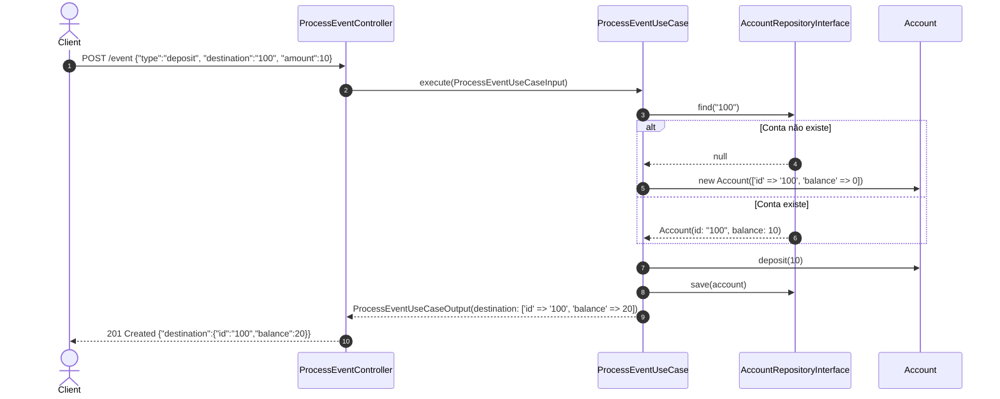
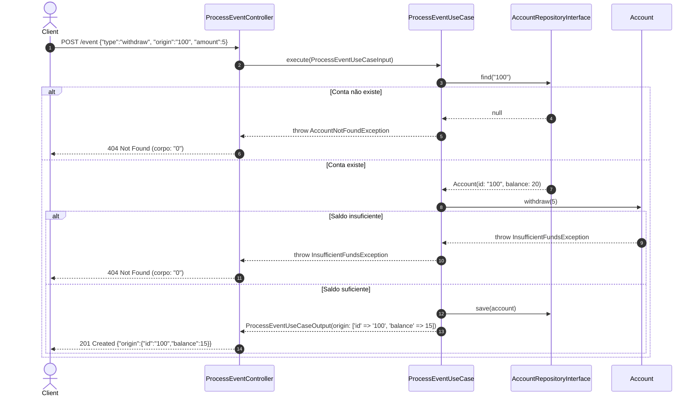
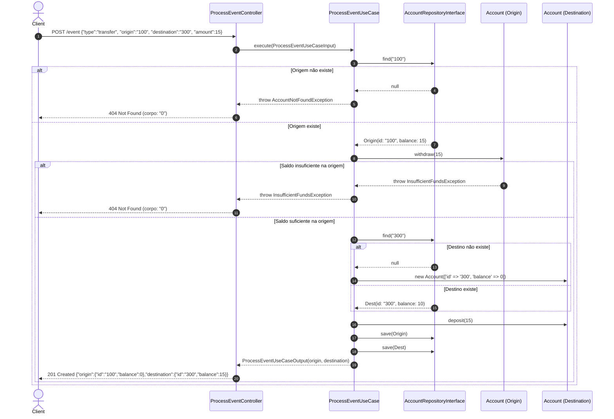

# Data Model: SPEC-05 — Processamento de Eventos Financeiros, Tríade do UseCase e Endpoint POST /event

Este documento define os modelos de dados, DTOs de entrada e saída, entidades de domínio, exceções e diagramas de sequência envolvidos no processamento de eventos financeiros (`deposit`, `withdraw`, `transfer`).

---

## 1. DTO de Entrada: `ProcessEventUseCaseInput`

- **Localização:** `app/UseCases/Account/ProcessEvent/ProcessEventUseCaseInput.php`
- **Mutabilidade:** Imutável (`readonly class`).
- **Finalidade:** Encapsula os dados normalizados e validados do evento para consumo exclusivo pela camada de aplicação.

### Atributos e Métodos
```php
namespace App\UseCases\Account\ProcessEvent;

use App\Http\Requests\Account\ProcessEventRequest;

final readonly class ProcessEventUseCaseInput
{
    public function __construct(
        public string $type,
        public int|float $amount,
        public ?string $origin = null,
        public ?string $destination = null,
    ) {}

    public static function fromRequest(ProcessEventRequest $request): self
    {
        return self::fromArray($request->validated());
    }

    /**
     * @param array<string, mixed> $data
     */
    public static function fromArray(array $data): self
    {
        return new self(
            type: (string) ($data['type'] ?? ''),
            amount: is_numeric($data['amount'] ?? null) ? (int|float) $data['amount'] : 0,
            origin: isset($data['origin']) ? (string) $data['origin'] : null,
            destination: isset($data['destination']) ? (string) $data['destination'] : null,
        );
    }
}
```

---

## 2. DTO de Saída: `ProcessEventUseCaseOutput`

- **Localização:** `app/UseCases/Account/ProcessEvent/ProcessEventUseCaseOutput.php`
- **Mutabilidade:** Imutável (`readonly class`).
- **Finalidade:** Transporta as contas consolidadas após o processamento, fornecendo serialização limpa sem chaves nulas para o Controller.

### Atributos e Métodos
```php
namespace App\UseCases\Account\ProcessEvent;

final readonly class ProcessEventUseCaseOutput
{
    /**
     * @param array{id: string, balance: int|float}|null $origin
     * @param array{id: string, balance: int|float}|null $destination
     */
    public function __construct(
        public ?array $origin = null,
        public ?array $destination = null,
    ) {}

    /**
     * @return array<string, array{id: string, balance: int|float}>
     */
    public function toArray(): array
    {
        return array_filter([
            'origin' => $this->origin,
            'destination' => $this->destination,
        ], static fn (?array $account): bool => $account !== null);
    }
}
```

---

## 3. Entidade de Domínio: `Account` (Model Eloquent)

- **Localização:** `app/Models/Account.php`
- **Finalidade:** Centraliza as regras de negócio e mutações de saldo financeiro, protegendo as invariantes do aggregate.

### Invariantes e Métodos de Negócio
- `$account->deposit(int|float $amount): void`
  - Requer que `$amount > 0`.
  - Incrementa o atributo `$this->balance`.
- `$account->withdraw(int|float $amount): void`
  - Requer que `$amount > 0`.
  - Verifica se `$this->balance >= $amount`. Se insuficiente, dispara `InsufficientFundsException`.
  - Decrementa o atributo `$this->balance`.

---

## 4. Exceções de Domínio

### 4.1 `AccountNotFoundException`
- **Localização:** `app/Exceptions/AccountNotFoundException.php`
- **Herança:** `\Exception` (pura, agnóstica de HTTP).
- **Disparada quando:** A conta de origem em `withdraw` ou `transfer` não é encontrada no repositório.

### 4.2 `InsufficientFundsException`
- **Localização:** `app/Exceptions/InsufficientFundsException.php`
- **Herança:** `\Exception` (pura, agnóstica de HTTP).
- **Disparada quando:** A conta de origem possui saldo inferior ao valor solicitado para débito.

---

## 5. Diagramas de Sequência e Fluxo Operacional

### 5.1 Fluxo de Depósito (`deposit`)


### 5.2 Fluxo de Saque (`withdraw`)


### 5.3 Fluxo de Transferência Atômica (`transfer`)


